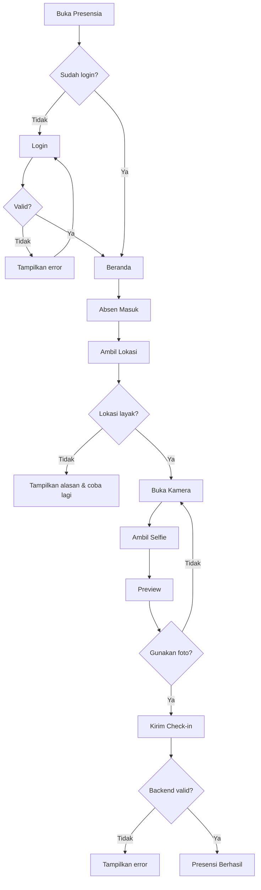
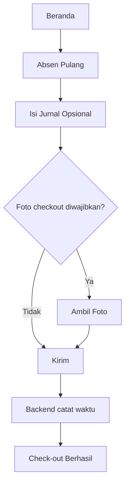
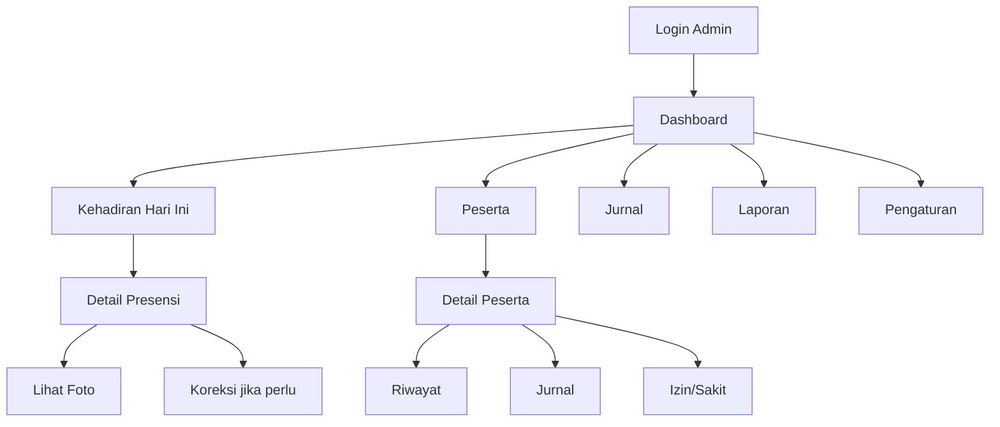
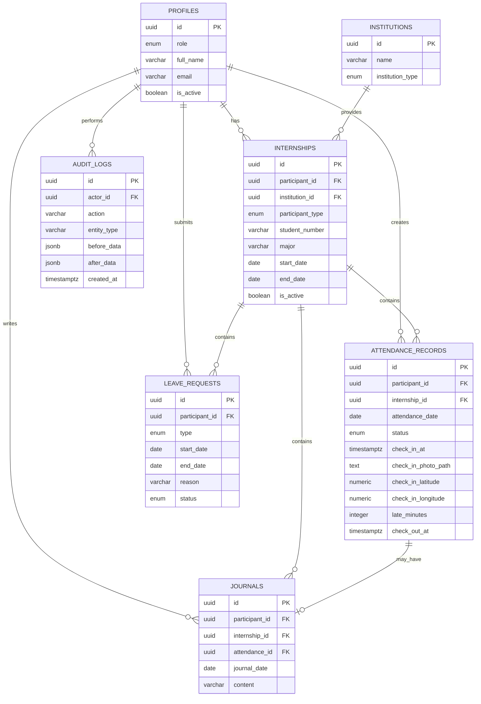
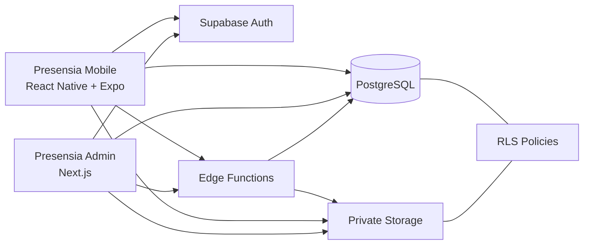

# PRD — Presensia

> **Platform Presensi &amp; Monitoring PKL/Magang Diskominfo Provinsi Banten**  
> **Tagline:** *Hadir. Tercatat. Terpantau.*

---

## 1. Informasi Dokumen


| Item                 | Detail                                                              |
| -------------------- | ------------------------------------------------------------------- |
| Nama produk          | Presensia                                                           |
| Jenis produk         | Mobile App + Web Admin                                              |
| Versi dokumen        | 1.0                                                                 |
| Status               | Draft untuk Review                                                  |
| Tanggal              | 22 September 2026                                                   |
| Pemilik produk       | Diskominfo Provinsi Banten / Tim Pengelola PKL &amp; Magang         |
| Target pengguna      | Siswa SMK PKL, mahasiswa/mahasiswi magang, pembina/pengelola magang |
| Platform peserta     | Android &amp; iOS                                                   |
| Platform admin       | Web responsif                                                       |
| Bahasa utama         | Bahasa Indonesia                                                    |
| Fokus versi          | MVP yang sederhana, berguna, aman, dan mudah dikembangkan           |
| Nama internal produk | Presensia                                                           |


### 1.1 Status Keputusan

Dokumen ini membedakan keputusan menjadi:

- **Diketahui:** berasal dari kebutuhan produk yang sudah ditetapkan.
- **Asumsi:** keputusan sementara agar implementasi dapat dirancang dengan jelas.
- **Rekomendasi:** keputusan teknis/produk yang disarankan karena paling sesuai untuk MVP.
- **Perlu Konfirmasi:** keputusan yang berdampak pada operasional, keamanan, atau kebijakan internal Diskominfo.

---

## 2. Ringkasan Produk

**Presensia** adalah aplikasi presensi digital untuk siswa SMK yang menjalani PKL serta mahasiswa/mahasiswi yang menjalani program magang di **Diskominfo Provinsi Banten**.

Produk terdiri dari dua antarmuka utama:

1. **Presensia Mobile**, digunakan peserta untuk melakukan presensi masuk dengan foto selfie, validasi lokasi, presensi pulang, melihat riwayat kehadiran, mengisi jurnal harian opsional, serta mengajukan izin atau sakit.
2. **Presensia Admin**, berupa web dashboard yang digunakan pembina/pengelola magang untuk memantau kehadiran peserta, melihat bukti foto presensi, data peserta, jurnal, izin/sakit, rekap kehadiran, dan laporan.

Presensia sengaja dirancang **tidak terlalu kompleks**. Produk tidak dimaksudkan menjadi sistem HR, payroll, LMS, project management, atau sistem akademik penuh. Tujuan utamanya adalah membuat proses presensi peserta PKL/magang lebih terpercaya, terstruktur, mudah dipantau, dan mudah direkap.

---

## 3. Latar Belakang dan Masalah

### 3.1 Kondisi yang Ingin Diperbaiki

Pengelolaan presensi PKL dan magang yang dilakukan secara manual atau melalui media yang tidak terstruktur menimbulkan beberapa masalah:

- pembina sulit memastikan peserta benar-benar hadir;
- waktu kedatangan dan kepulangan tidak tercatat secara konsisten;
- bukti kehadiran tersebar atau tidak tersedia;
- rekap kehadiran membutuhkan pekerjaan manual;
- pembina sulit melihat peserta yang sering terlambat atau tidak hadir;
- informasi peserta dari berbagai sekolah/universitas tidak berada dalam satu sistem;
- jurnal kegiatan peserta, jika ada, tidak terhubung dengan data kehadiran;
- pencarian riwayat peserta membutuhkan waktu lebih lama.

### 3.2 Masalah Utama Pengguna

#### Peserta

- membutuhkan proses presensi yang cepat;
- tidak ingin mengisi form panjang setiap hari;
- ingin mengetahui apakah presensi berhasil;
- ingin melihat riwayat kehadirannya sendiri;
- membutuhkan cara sederhana untuk memberi keterangan izin/sakit;
- jika membuat jurnal, prosesnya harus singkat dan tidak membebani.

#### Pembina/Admin

- ingin mengetahui siapa yang hadir hari ini;
- ingin melihat bukti foto dari presensi peserta;
- ingin mengetahui siapa yang terlambat, izin, sakit, atau belum hadir;
- ingin melihat informasi lengkap peserta;
- ingin melihat perkembangan kehadiran individu;
- membutuhkan laporan/rekap yang dapat diekspor;
- membutuhkan koreksi data dengan jejak perubahan jika ada kesalahan.

---

## 4. Visi Produk

Menjadi platform presensi PKL dan magang yang sederhana tetapi dapat dipercaya, sehingga peserta dapat melakukan presensi dalam hitungan detik dan pembina dapat memantau kehadiran tanpa proses manual yang rumit.

---

## 5. Tujuan Produk

### 5.1 Tujuan Utama

1. Mendigitalisasi proses presensi peserta PKL dan magang.
2. Menyediakan bukti presensi berupa foto, waktu server, dan lokasi.
3. Mempermudah pembina melihat kondisi kehadiran hari ini.
4. Menyediakan data peserta dari berbagai sekolah/universitas dalam satu sistem.
5. Mengurangi pekerjaan manual dalam pembuatan rekap kehadiran.
6. Menyediakan jurnal kegiatan sederhana tanpa menjadikannya kewajiban yang membebani peserta.
7. Menyediakan histori kehadiran yang mudah ditelusuri.

### 5.2 Indikator Keberhasilan Awal

**Rekomendasi target MVP:**

- ≥ 95% presensi berhasil dicatat tanpa bantuan admin pada kondisi jaringan normal.
- Peserta dapat menyelesaikan check-in normal dalam ≤ 30 detik setelah aplikasi siap.
- Admin dapat mengetahui status kehadiran hari ini maksimal dalam 2 klik setelah login.
- Data presensi tidak dapat dibuat ganda untuk peserta dan tanggal yang sama.
- Laporan bulanan dapat diekspor tanpa pengolahan manual tambahan untuk data inti.
- Foto presensi hanya dapat diakses oleh peserta terkait dan admin berwenang.

---

## 6. Non-Goals

Presensia versi pertama **tidak** ditujukan untuk:

- payroll atau penggajian;
- absensi pegawai Diskominfo;
- facial recognition atau pencocokan wajah otomatis;
- live tracking lokasi peserta;
- chat realtime antara peserta dan pembina;
- sistem tugas seperti Trello/Jira;
- e-learning/LMS;
- sistem nilai akademik lengkap;
- gamification, poin, ranking, atau leaderboard;
- QR attendance;
- integrasi biometrik perangkat;
- multi-level approval yang kompleks;
- pengelolaan surat menyurat lengkap;
- pengelolaan inventaris;
- otomatisasi berbasis AI;
- sistem rekrutmen peserta magang.

Fitur tersebut dapat dipertimbangkan pada fase selanjutnya hanya jika ada kebutuhan operasional yang nyata.

---

## 7. Target Pengguna dan Persona

### 7.1 Peserta SMK PKL

**Karakteristik**

- siswa SMK aktif;
- mengikuti PKL di Diskominfo Provinsi Banten;
- menggunakan smartphone Android/iOS.

**Kebutuhan**

- presensi masuk cepat;
- bukti bahwa presensi berhasil;
- melihat riwayat;
- mengisi jurnal singkat bila diperlukan;
- mengajukan izin/sakit.

**Perangkat utama**

- smartphone.

### 7.2 Mahasiswa/Mahasiswi Magang

**Karakteristik**

- berasal dari perguruan tinggi;
- mengikuti program magang pada periode tertentu;
- dapat berasal dari jurusan dan kampus berbeda.

**Kebutuhan**

- sama dengan peserta SMK;
- membutuhkan data periode magang dan asal institusi tercatat rapi.

### 7.3 Pembina/Pengelola Magang

**Karakteristik**

- staf yang bertanggung jawab memantau peserta PKL/magang;
- menggunakan komputer/laptop lebih sering daripada smartphone.

**Kebutuhan**

- melihat peserta aktif;
- melihat kehadiran hari ini;
- membuka bukti foto;
- melihat histori peserta;
- mengelola izin/sakit;
- melakukan koreksi data jika diperlukan;
- mengekspor laporan.

---

## 8. Role dan Hak Akses

MVP menggunakan **dua role** agar sistem tetap sederhana.


| Role        | Hak akses utama                                                                                                     | Batasan                                                                                                       |
| ----------- | ------------------------------------------------------------------------------------------------------------------- | ------------------------------------------------------------------------------------------------------------- |
| Participant | Login, check-in, check-out, melihat data sendiri, jurnal sendiri, riwayat sendiri, izin/sakit sendiri               | Tidak dapat melihat peserta lain, mengubah waktu presensi, mengubah status secara manual, mengubah pengaturan |
| Admin       | Kelola peserta, melihat seluruh presensi, bukti foto, jurnal, izin/sakit, laporan, jadwal, pengaturan, koreksi data | Tidak boleh mengakses sistem tanpa autentikasi; perubahan penting wajib tercatat                              |


### 8.1 Prinsip Otorisasi

- Hak akses harus diterapkan di sisi backend/database, bukan hanya menyembunyikan tombol pada UI.
- Participant hanya boleh membaca/mengubah data miliknya sesuai aturan.
- Admin dapat mengakses data peserta dalam ruang lingkup Presensia.
- Endpoint administratif sensitif tidak boleh dapat dipanggil oleh participant.
- Setiap koreksi status/waktu oleh admin wajib menyimpan alasan dan audit log.

---

## 9. Ruang Lingkup Produk

### 9.1 MVP — Must Have

#### Mobile Peserta

- login;
- lupa/reset password;
- halaman beranda;
- check-in dengan selfie;
- pengambilan GPS saat check-in;
- validasi radius lokasi;
- waktu dari server;
- status hadir/terlambat otomatis;
- check-out;
- jurnal harian opsional;
- riwayat kehadiran;
- detail kehadiran;
- pengajuan izin/sakit;
- profil peserta;
- logout.

#### Web Admin

- login admin;
- dashboard hari ini;
- statistik kehadiran;
- daftar kehadiran hari ini;
- preview foto presensi;
- daftar peserta;
- tambah/edit/nonaktifkan peserta;
- detail peserta;
- riwayat kehadiran peserta;
- daftar jurnal;
- daftar dan approval izin/sakit;
- filter presensi;
- koreksi presensi dengan alasan;
- rekap/laporan;
- export CSV/XLSX;
- pengaturan jam kerja;
- pengaturan toleransi terlambat;
- pengaturan lokasi dan radius presensi;
- audit log dasar.

### 9.2 Should Have

- indikator “Perlu Perhatian” di dashboard;
- kalender kehadiran pada mobile;
- upload lampiran izin/sakit;
- pencarian cepat peserta;
- filter berdasarkan sekolah/universitas;
- indikator periode magang segera berakhir;
- foto check-out yang dapat diaktifkan/nonaktifkan dari pengaturan.

### 9.3 Could Have — Fase Selanjutnya

- push notification pengingat presensi;
- export PDF;
- multiple office/location;
- role pembina per unit;
- komentar pembina pada jurnal;
- impor peserta dari Excel;
- dashboard statistik periodik yang lebih lengkap;
- tanda tangan laporan;
- SSO pemerintah/instansi jika tersedia dan diperlukan.

### 9.4 Won't Have for Now

- facial recognition;
- live tracking;
- chat;
- AI;
- payroll;
- gamification;
- QR code;
- sistem tugas;
- sistem nilai akademik kompleks.

---

## 10. Prioritas Fitur


| ID    | Fitur                           | Prioritas   | Alasan                         |
| ----- | ------------------------------- | ----------- | ------------------------------ |
| F-001 | Login peserta/admin             | Must Have   | Gerbang akses                  |
| F-002 | Check-in selfie                 | Must Have   | Fungsi utama produk            |
| F-003 | Validasi GPS                    | Must Have   | Bukti lokasi kehadiran         |
| F-004 | Status hadir/terlambat otomatis | Must Have   | Monitoring objektif            |
| F-005 | Check-out                       | Must Have   | Mencatat akhir aktivitas       |
| F-006 | Jurnal opsional                 | Must Have   | Konteks aktivitas harian       |
| F-007 | Riwayat peserta                 | Must Have   | Transparansi data              |
| F-008 | Dashboard admin                 | Must Have   | Monitoring utama               |
| F-009 | Preview bukti foto              | Must Have   | Verifikasi kehadiran           |
| F-010 | Data peserta                    | Must Have   | Master data                    |
| F-011 | Izin/sakit                      | Must Have   | Menangani ketidakhadiran       |
| F-012 | Rekap &amp; export              | Must Have   | Kebutuhan administrasi         |
| F-013 | Perlu Perhatian                 | Should Have | Mempercepat monitoring         |
| F-014 | Audit log                       | Must Have   | Akuntabilitas perubahan        |
| F-015 | Foto check-out opsional         | Should Have | Bukti tambahan bila diperlukan |


---

# 11. Functional Requirements

## FR-001 — Login Participant

- **Aktor:** Participant.
- **Prasyarat:** akun telah dibuat/diundang oleh admin dan berstatus aktif.
- **Input:** email, password.
- **Alur utama:**
  1. participant membuka aplikasi;
  2. memasukkan email/password;
  3. sistem melakukan autentikasi;
  4. sistem mengambil profil participant;
  5. participant diarahkan ke Beranda.
- **Validasi:**
  - email harus valid;
  - password tidak boleh kosong;
  - akun harus aktif.
- **Berhasil:** session tersimpan secara aman.
- **Gagal:** tampilkan pesan yang aman tanpa membocorkan detail sensitif.
- **Prioritas:** Must Have.

### Acceptance Criteria

- pengguna valid dapat masuk;
- password salah ditolak;
- akun nonaktif ditolak;
- participant tidak dapat masuk ke admin dashboard;
- session tetap tersedia sesuai konfigurasi autentikasi.

---

## FR-002 — Login Admin

- **Aktor:** Admin.
- **Platform:** Web.
- **Input:** email, password.
- **Hasil:** diarahkan ke dashboard.
- **Keamanan:** hanya akun dengan role `admin` yang boleh mengakses route admin.

---

## FR-003 — Check-in

- **Aktor:** Participant.
- **Prasyarat:**
  - sudah login;
  - akun aktif;
  - periode PKL/magang masih aktif;
  - hari merupakan hari kerja;
  - belum check-in pada tanggal tersebut;
  - izin kamera dan lokasi tersedia.
- **Alur:**
  1. participant menekan `Absen Masuk`;
  2. aplikasi meminta lokasi;
  3. jika lokasi memenuhi syarat, kamera selfie dibuka;
  4. participant mengambil foto;
  5. preview foto ditampilkan;
  6. participant memilih `Gunakan Foto`;
  7. foto diunggah ke storage privat;
  8. request check-in dikirim ke backend;
  9. backend memvalidasi user, waktu server, duplikasi, lokasi, dan jadwal;
  10. backend menentukan status;
  11. presensi disimpan;
  12. aplikasi menampilkan hasil.
- **Output:**
  - timestamp check-in;
  - status;
  - foto;
  - lokasi;
  - late minutes.
- **Gagal jika:**
  - di luar radius;
  - lokasi tidak tersedia;
  - foto gagal;
  - sudah check-in;
  - periode tidak aktif;
  - hari bukan hari kerja;
  - request gagal.

### Aturan

- waktu perangkat tidak digunakan sebagai sumber waktu resmi;
- selfie wajib untuk check-in;
- satu participant hanya memiliki satu record presensi per tanggal;
- backend menjadi sumber kebenaran.

---

## FR-004 — Validasi Lokasi Check-in

- **Aktor:** sistem.
- **Input:** latitude, longitude, accuracy dari perangkat.
- **Pengaturan:** titik kantor dan radius dari admin settings.
- **Rekomendasi default:** radius 150 meter — **Perlu Konfirmasi**.
- **Aturan:**
  - backend menghitung jarak ke titik kantor;
  - jika GPS accuracy terlalu buruk, aplikasi meminta participant mengambil lokasi ulang;
  - lokasi hanya diambil ketika proses presensi, bukan dilacak terus-menerus.
- **Privacy:** tidak ada live tracking.

---

## FR-005 — Penentuan Status Hadir/Terlambat

- **Aktor:** backend.
- **Input:** waktu server + pengaturan jadwal.
- **Contoh asumsi:**
  - jam masuk 08:00;
  - toleransi 15 menit;
  - sampai 08:15 → `HADIR`;
  - setelah 08:15 → `TERLAMBAT`.
- **Output:** `status`, `late_minutes`.
- **Catatan:** nilai jam dan toleransi harus dapat diubah admin.

---

## FR-006 — Check-out

- **Aktor:** Participant.
- **Prasyarat:** sudah check-in.
- **Alur:**
  1. participant menekan `Absen Pulang`;
  2. sistem menampilkan jurnal opsional;
  3. jika konfigurasi mewajibkan foto check-out, kamera dibuka;
  4. backend mencatat waktu server;
  5. record attendance diperbarui.
- **Aturan:**
  - check-out tidak dapat dilakukan sebelum check-in;
  - satu kali check-out per hari;
  - jurnal tetap opsional;
  - selfie check-out default **tidak wajib**, tetapi dapat diaktifkan admin.
- **Hasil:** waktu pulang tersimpan.

---

## FR-007 — Jurnal Harian

- **Aktor:** Participant.
- **Tujuan:** mencatat kegiatan singkat.
- **Field:**
  - tanggal;
  - isi jurnal.
- **Rekomendasi panjang:** 1–500 karakter jika diisi.
- **Status:** opsional.
- **Aturan:**
  - maksimum satu jurnal per participant per tanggal;
  - participant dapat mengedit jurnal miliknya pada hari yang sama — **Rekomendasi**;
  - setelah hari berakhir, jurnal hanya-baca untuk participant — **Asumsi**;
  - admin dapat melihat jurnal.

---

## FR-008 — Riwayat Kehadiran Participant

Participant dapat melihat:

- tanggal;
- status;
- jam masuk;
- jam pulang;
- indikator jurnal;
- detail foto miliknya;
- lokasi dalam bentuk status valid/tidak valid.

Filter minimum:

- bulan.

Default:

- bulan berjalan;
- terbaru lebih dulu.

---

## FR-009 — Pengajuan Izin/Sakit

- **Aktor:** Participant.
- **Tipe:** `IZIN` atau `SAKIT`.
- **Field:**
  - tipe;
  - tanggal mulai;
  - tanggal selesai;
  - alasan;
  - lampiran opsional.
- **Validasi:**
  - tanggal selesai &gt;= tanggal mulai;
  - alasan wajib;
  - tidak boleh overlap dengan pengajuan aktif yang sama;
  - ukuran dan tipe file dibatasi.
- **Status:** `PENDING`, `APPROVED`, `REJECTED`.
- **Admin:** dapat setujui/tolak dengan catatan opsional.

---

## FR-010 — Dashboard Admin

Dashboard menampilkan data hari ini:

### Summary Cards

- peserta aktif;
- hadir;
- terlambat;
- izin/sakit;
- belum hadir.

### Kehadiran Hari Ini

Kolom:

- foto profil/avatar;
- nama;
- institusi;
- jam masuk;
- jam pulang;
- status;
- tombol/thumbnail bukti foto.

### Perlu Perhatian

Contoh kondisi:

- participant aktif belum check-in;
- terlambat ≥ 3 kali pada minggu berjalan — **Rekomendasi**;
- tidak hadir tanpa keterangan;
- periode magang berakhir ≤ 7 hari.

Dashboard tidak membutuhkan chart kompleks pada MVP.

---

## FR-011 — Preview Bukti Foto

- admin dapat klik thumbnail;
- foto tampil dalam modal/lightbox;
- metadata ditampilkan:
  - participant;
  - tanggal;
  - waktu check-in;
  - status;
  - status validasi lokasi;
- foto disajikan melalui akses terproteksi/signed URL;
- URL permanen publik dilarang.

---

## FR-012 — Manajemen Participant

Admin dapat:

- melihat daftar;
- mencari;
- filter;
- tambah participant;
- edit data participant;
- mengaktifkan/nonaktifkan akun;
- membuka detail participant.

### Field Participant

- nama lengkap;
- NIS/NIM;
- tipe participant (`SMK_PKL`, `UNIVERSITY_INTERN`);
- institusi;
- jurusan;
- email;
- nomor HP opsional;
- tanggal mulai;
- tanggal selesai;
- foto profil opsional;
- status aktif.

### Akun

**Rekomendasi:** participant tidak melakukan registrasi publik. Admin membuat/undang akun menggunakan email.

---

## FR-013 — Detail Participant

Tampilkan:

- foto profil;
- nama;
- NIS/NIM;
- tipe participant;
- asal institusi;
- jurusan;
- periode;
- status akun.

### Ringkasan

- total hari kerja terhitung;
- hadir;
- terlambat;
- izin;
- sakit;
- tidak hadir;
- persentase kehadiran.

### Tab

1. Kehadiran;
2. Jurnal;
3. Izin/Sakit.

---

## FR-014 — Daftar Kehadiran Admin

Admin dapat:

- mencari nama/NIS/NIM;
- filter tanggal/rentang;
- filter status;
- filter institusi;
- filter tipe participant;
- membuka detail;
- membuka foto;
- melakukan koreksi dengan hak akses admin.

---

## FR-015 — Koreksi Presensi Admin

Koreksi digunakan hanya untuk menangani kesalahan operasional.

Admin dapat mengubah:

- status;
- jam masuk;
- jam pulang.

Syarat:

- alasan koreksi wajib;
- nilai sebelum dan sesudah disimpan pada audit log;
- UI menandai record yang pernah dikoreksi;
- participant tidak dapat melakukan koreksi sendiri.

---

## FR-016 — Approval Izin/Sakit

Admin dapat:

- membuka pengajuan;
- melihat alasan/lampiran;
- memilih `Setujui` atau `Tolak`;
- memasukkan catatan opsional.

Jika disetujui:

- tanggal terkait harus tercermin sebagai `IZIN` atau `SAKIT` pada laporan kehadiran.

---

## FR-017 — Laporan dan Export

Admin memilih:

- tanggal mulai;
- tanggal selesai;
- institusi opsional;
- participant opsional;
- status opsional.

Output minimum:

- nama;
- NIS/NIM;
- institusi;
- jurusan;
- tanggal;
- jam masuk;
- jam pulang;
- status;
- keterlambatan;
- keterangan.

Format MVP:

- XLSX;
- CSV.

PDF:

- Could Have.

---

## FR-018 — Pengaturan Presensi

Admin dapat mengatur:

- hari kerja;
- jam masuk;
- toleransi keterlambatan;
- jam pulang;
- nama lokasi;
- latitude;
- longitude;
- radius;
- selfie check-out wajib/tidak;
- batas panjang jurnal.

Perubahan setting harus memiliki `updated_at` dan `updated_by`.

---

## FR-019 — Audit Log

Catat aksi administratif penting:

- participant dibuat;
- participant diedit;
- participant dinonaktifkan;
- presensi dikoreksi;
- izin/sakit disetujui/ditolak;
- pengaturan presensi diubah.

Data minimum:

- actor;
- action;
- entity type;
- entity id;
- before;
- after;
- reason jika relevan;
- timestamp.

---

## FR-020 — Logout

- participant/admin dapat logout;
- token/session lokal dihapus sesuai mekanisme auth;
- route private tidak dapat diakses setelah logout.

---

# 12. Business Rules

## BR-001 — Satu Presensi Per Hari

Satu participant hanya dapat memiliki satu record kehadiran per tanggal kalender operasional.

## BR-002 — Waktu Resmi dari Server

Check-in/check-out menggunakan timestamp backend/database, bukan waktu yang dikirim perangkat.

## BR-003 — Selfie Check-in Wajib

Check-in tidak valid tanpa bukti selfie.

## BR-004 — Lokasi Wajib saat Check-in

Participant harus mengizinkan lokasi ketika check-in.

## BR-005 — Tidak Ada Live Tracking

Lokasi hanya dikumpulkan pada aksi presensi yang membutuhkan lokasi.

## BR-006 — Radius Presensi

Check-in hanya diterima jika berada dalam radius yang ditentukan.

## BR-007 — Status Otomatis

`HADIR` atau `TERLAMBAT` ditentukan backend berdasarkan jadwal.

## BR-008 — Ketidakhadiran

Participant aktif yang tidak memiliki check-in atau izin/sakit disetujui pada hari kerja dapat dikategorikan `TIDAK_HADIR` setelah hari operasional ditutup.

## BR-009 — Izin/Sakit Menimpa Tidak Hadir

Pengajuan yang disetujui menghasilkan status `IZIN` atau `SAKIT` pada tanggal terkait.

## BR-010 — Jurnal Opsional

Kegagalan mengisi jurnal tidak membatalkan check-out.

## BR-011 — Periode Aktif

Participant hanya dapat presensi jika tanggal berada dalam periode PKL/magang aktif.

## BR-012 — Akun Nonaktif

Akun nonaktif tidak dapat login/presensi.

## BR-013 — Admin Correction

Admin dapat melakukan koreksi hanya dengan alasan yang tercatat.

## BR-014 — Bukti Foto Privat

Foto presensi tidak boleh tersedia melalui public bucket tanpa proteksi.

## BR-015 — Zona Waktu

Semua tampilan operasional menggunakan zona waktu **Asia/Jakarta (WIB)**. Database direkomendasikan menyimpan `timestamptz`/UTC dan mengonversi pada presentation layer.

## BR-016 — Hari Libur

MVP minimal memiliki pengaturan hari kerja mingguan. Dukungan kalender hari libur khusus dapat ditambahkan sebagai Should Have jika diperlukan.

---

# 13. Status dan Siklus Data

## 13.1 Attendance Status

```text
HADIR
TERLAMBAT
IZIN
SAKIT
TIDAK_HADIR
```

`BELUM_HADIR` digunakan sebagai **status tampilan/dashboard**, bukan wajib sebagai nilai permanen database sebelum hari selesai.

## 13.2 Leave Request

```text
PENDING → APPROVED
        ↘ REJECTED
```

## 13.3 Participant

```text
ACTIVE → INACTIVE
```

Dapat diaktifkan kembali oleh admin bila dibutuhkan.

---

# 14. User Stories

## US-001

Sebagai participant, saya ingin melakukan check-in dengan selfie agar kehadiran saya tercatat dan memiliki bukti.

## US-002

Sebagai participant, saya ingin langsung mengetahui apakah saya hadir atau terlambat agar status kehadiran saya jelas.

## US-003

Sebagai participant, saya ingin melihat riwayat kehadiran agar saya dapat memeriksa data saya sendiri.

## US-004

Sebagai participant, saya ingin mengisi jurnal singkat agar pembina mengetahui kegiatan saya tanpa laporan harian yang rumit.

## US-005

Sebagai participant, saya ingin mengajukan izin/sakit agar ketidakhadiran saya memiliki keterangan resmi.

## US-006

Sebagai admin, saya ingin melihat siapa yang hadir hari ini agar monitoring dapat dilakukan dengan cepat.

## US-007

Sebagai admin, saya ingin membuka foto presensi agar saya dapat melihat bukti kehadiran participant.

## US-008

Sebagai admin, saya ingin melihat histori satu participant agar saya dapat memantau konsistensi kehadirannya.

## US-009

Sebagai admin, saya ingin mengunduh laporan agar data dapat digunakan untuk administrasi.

## US-010

Sebagai admin, saya ingin mengoreksi data dengan alasan agar kesalahan dapat diperbaiki tanpa kehilangan jejak perubahan.

---

# 15. Acceptance Criteria Utama

## AC-001 — Check-in Berhasil

**Given** participant aktif, berada dalam periode magang, berada dalam radius, belum presensi, dan memberi izin kamera/lokasi  
**When** participant mengambil selfie valid dan mengirim check-in  
**Then** backend menyimpan foto, waktu server, lokasi, dan status kehadiran satu kali.

## AC-002 — Check-in Ganda

**Given** participant sudah check-in hari ini  
**When** participant mencoba check-in kembali  
**Then** sistem menolak request dan tidak membuat record kedua.

## AC-003 — Lokasi Tidak Valid

**Given** participant berada di luar radius  
**When** participant melakukan check-in  
**Then** check-in ditolak dan alasan lokasi ditampilkan.

## AC-004 — Manipulasi Jam Perangkat

**Given** jam smartphone diubah  
**When** participant melakukan check-in  
**Then** waktu resmi tetap mengikuti server.

## AC-005 — Dashboard

**Given** admin login  
**When** membuka dashboard  
**Then** sistem menampilkan ringkasan hari ini dan daftar participant dengan status terkini.

## AC-006 — Foto Privat

**Given** pengguna tidak memiliki akses  
**When** mencoba membuka file presensi langsung  
**Then** storage menolak akses.

## AC-007 — Koreksi

**Given** admin melakukan koreksi  
**When** perubahan disimpan  
**Then** alasan, nilai sebelumnya, nilai baru, admin, dan timestamp dicatat.

## AC-008 — Jurnal Opsional

**Given** participant sudah check-in  
**When** melakukan check-out tanpa jurnal  
**Then** check-out tetap berhasil.

## AC-009 — Export

**Given** admin memilih periode valid  
**When** menekan export XLSX  
**Then** file berisi seluruh record sesuai filter.

---

# 16. User Flow

## 16.1 Flow Participant — Login dan Check-in



## 16.2 Flow Check-out



## 16.3 Flow Admin



---

# 17. Struktur Navigasi Mobile

Bottom Navigation:

1. **Beranda**
2. **Riwayat**
3. **Jurnal**
4. **Profil**

### 17.1 Beranda

**Tujuan:** menyelesaikan presensi secepat mungkin.

Komponen:

- sapaan;
- tanggal;
- status hari ini;
- jam masuk/pulang jika ada;
- tombol CTA check-in/check-out;
- status lokasi saat proses;
- shortcut jurnal;
- informasi pengajuan izin aktif.

State:

- belum check-in;
- sudah check-in;
- sudah check-out;
- izin/sakit;
- bukan hari kerja;
- periode belum mulai;
- periode selesai;
- loading;
- error jaringan.

### 17.2 Riwayat

Komponen:

- filter bulan;
- daftar tanggal;
- badge status;
- jam masuk/pulang;
- detail saat diklik.

### 17.3 Jurnal

Komponen:

- jurnal hari ini;
- textarea;
- simpan;
- riwayat jurnal.

Empty state:

> Belum ada jurnal untuk hari ini. Jurnal bersifat opsional.

### 17.4 Profil

Komponen:

- foto;
- nama;
- NIS/NIM;
- institusi;
- jurusan;
- periode;
- email;
- logout.

---

# 18. Struktur Navigasi Web Admin

Sidebar:

1. **Dashboard**
2. **Peserta**
3. **Kehadiran**
4. **Jurnal**
5. **Izin &amp; Sakit**
6. **Laporan**
7. **Pengaturan**

Audit log dapat ditempatkan di Pengaturan agar sidebar tetap ringkas.

---

# 19. Spesifikasi Halaman Web Admin

## 19.1 Dashboard

### Header

- `Dashboard`
- tanggal hari ini;
- admin profile menu.

### Cards

- Participant Aktif
- Hadir
- Terlambat
- Izin/Sakit
- Belum Hadir

### Tabel Kehadiran Hari Ini

Kolom:

- participant;
- asal;
- jam masuk;
- jam pulang;
- status;
- bukti;
- aksi.

### Perlu Perhatian

Rules rekomendasi:

- belum check-in sampai setelah jam masuk;
- terlambat 3x pada minggu berjalan;
- periode selesai ≤ 7 hari;
- izin pending.

---

## 19.2 Peserta

### Tabel

- foto/avatar;
- nama;
- NIS/NIM;
- kategori;
- institusi;
- periode;
- status;
- aksi.

### Search

- nama;
- NIS/NIM;
- email.

### Filter

- kategori;
- institusi;
- status;
- periode aktif.

### Actions

- tambah;
- edit;
- detail;
- nonaktifkan.

Pagination:

- default 20 per halaman;
- opsi 20/50/100.

---

## 19.3 Kehadiran

Filter:

- tanggal/range;
- participant;
- institusi;
- status.

Kolom:

- tanggal;
- participant;
- institusi;
- check-in;
- check-out;
- status;
- telat;
- foto;
- aksi.

Detail drawer/modal:

- foto besar;
- metadata;
- jurnal;
- status;
- correction history.

---

## 19.4 Jurnal

Kolom:

- tanggal;
- participant;
- institusi;
- ringkasan isi;
- aksi detail.

Filter:

- periode;
- participant;
- institusi.

---

## 19.5 Izin &amp; Sakit

Tabs:

- Pending
- Approved
- Rejected

Kolom:

- participant;
- tipe;
- tanggal;
- alasan;
- lampiran;
- status;
- aksi.

---

## 19.6 Laporan

Form:

- mulai;
- selesai;
- institusi;
- participant;
- status.

Output:

- preview tabel;
- `Export XLSX`;
- `Export CSV`.

---

## 19.7 Pengaturan

Bagian:

- Jadwal kerja;
- Keterlambatan;
- Lokasi presensi;
- Bukti check-out;
- Jurnal;
- Audit log.

---

# 20. Spesifikasi Form

## 20.1 Form Participant


| Field           | Tipe              | Wajib | Validasi                                   |
| --------------- | ----------------- | -----: | ------------------------------------------ |
| Nama lengkap    | Text              | Ya    | 2–100 karakter                             |
| NIS/NIM         | Text              | Ya    | 2–50 karakter, unik pada konteks institusi |
| Tipe            | Select            | Ya    | SMK PKL / Mahasiswa Magang                 |
| Institusi       | Searchable Select | Ya    | harus tersedia                             |
| Jurusan         | Text              | Ya    | 2–100 karakter                             |
| Email           | Email             | Ya    | valid dan unik                             |
| Nomor HP        | Tel               | Tidak | format wajar                               |
| Tanggal mulai   | Date              | Ya    | valid                                      |
| Tanggal selesai | Date              | Ya    | &gt;= tanggal mulai                        |
| Foto profil     | Image             | Tidak | JPG/PNG/WEBP sesuai batas                  |
| Status aktif    | Toggle            | Ya    | default aktif                              |


## 20.2 Form Jurnal


| Field      | Tipe     | Wajib | Validasi                   |
| ---------- | -------- | -----: | -------------------------- |
| Isi jurnal | Textarea | Tidak | maks. 500 karakter default |


## 20.3 Form Izin/Sakit


| Field           | Tipe     | Wajib | Validasi                   |
| --------------- | -------- | -----: | -------------------------- |
| Tipe            | Select   | Ya    | IZIN/SAKIT                 |
| Tanggal mulai   | Date     | Ya    | valid                      |
| Tanggal selesai | Date     | Ya    | &gt;= tanggal mulai        |
| Alasan          | Textarea | Ya    | 5–500 karakter             |
| Lampiran        | File     | Tidak | image/PDF, ukuran dibatasi |


## 20.4 Form Koreksi


| Field          | Tipe     | Wajib            |
| -------------- | -------- | ----------------: |
| Status         | Select   | sesuai kebutuhan |
| Jam masuk      | Time     | sesuai kebutuhan |
| Jam pulang     | Time     | sesuai kebutuhan |
| Alasan koreksi | Textarea | Ya               |


---

# 21. UI/UX Requirements

## 21.1 Prinsip Desain

- sederhana;
- bersih;
- ramah pengguna muda;
- profesional;
- tidak terasa seperti dashboard ERP;
- CTA presensi sangat jelas;
- minim langkah;
- tidak menggunakan biru sebagai warna primer;
- status harus terbaca melalui teks + ikon, bukan warna saja.

## 21.2 Color System


| Token        | Warna            | HEX       | Penggunaan                 |
| ------------ | ---------------- | --------- | -------------------------- |
| Primary      | Burnt Terracotta | `#B85C42` | tombol utama, active state |
| Secondary    | Muted Sage       | `#74866A` | aksen                      |
| Background   | Warm Ivory       | `#F7F4EF` | background utama           |
| Surface      | White            | `#FFFFFF` | card/modal                 |
| Text Primary | Charcoal         | `#252421` | teks utama                 |
| Text Muted   | Warm Gray        | `#77736D` | teks sekunder              |
| Success      | Forest Sage      | `#52705A` | hadir/sukses               |
| Warning      | Amber            | `#D58A32` | terlambat                  |
| Danger       | Muted Red        | `#C34F4F` | error/ditolak              |


Catatan:

- `#B85C42` dapat digunakan sebagai tombol dengan teks putih untuk ukuran teks normal.
- warna warning sebaiknya digunakan sebagai badge/background dengan teks gelap yang kontras, bukan teks putih kecil.
- desain harus diuji ulang terhadap WCAG untuk seluruh kombinasi final.

## 21.3 Typography

**Rekomendasi:** Plus Jakarta Sans atau Inter.

Skala:

- Display/heading seperlunya;
- body 14–16px;
- mobile body minimum 14px;
- tombol utama minimum 16px jika ruang memungkinkan.

## 21.4 Component Style

- border radius 12–16px;
- card tidak terlalu banyak shadow;
- whitespace cukup;
- icon line style;
- bottom sheet/modal untuk flow ringan di mobile;
- table pada admin dengan sticky header jika data panjang;
- skeleton/loading untuk state yang memerlukan fetch.

## 21.5 Responsiveness

### Mobile

Target minimum:

- lebar ~320px ke atas;
- Android/iOS modern yang didukung versi Expo yang digunakan.

### Web Admin

Breakpoints:

- desktop utama;
- tablet tetap usable;
- mobile web bersifat responsif tetapi bukan pengalaman utama admin.

---

# 22. Empty, Loading, Success, Error States

Setiap halaman penting harus memiliki:

### Loading

- skeleton atau spinner;
- tombol submit disabled selama proses.

### Empty

Contoh:

- “Belum ada riwayat kehadiran.”
- “Tidak ada izin yang menunggu persetujuan.”

### Success

- toast/banner singkat;
- jangan mengandalkan toast saja untuk aksi penting; UI utama harus memperlihatkan state baru.

### Error

- pesan manusiawi;
- tombol `Coba Lagi` jika bisa;
- jangan menampilkan stack trace/error internal.

---

# 23. Struktur Data dan Database

## 23.1 Teknologi Database

**Rekomendasi:** PostgreSQL melalui Supabase.

### Prinsip

- gunakan migration;
- primary key UUID;
- timestamp menggunakan `timestamptz`;
- constraint database untuk data kritis;
- gunakan unique index untuk mencegah presensi ganda;
- soft delete hanya jika memang diperlukan; untuk participant lebih sederhana menggunakan `is_active`.

---

## 23.2 Entity: `profiles`

Merepresentasikan profil akun.


| Field       | Type         | Constraint           |
| ----------- | ------------ | -------------------- |
| id          | uuid         | PK, FK auth.users.id |
| role        | enum         | participant/admin    |
| full_name   | varchar(100) | not null             |
| email       | varchar      | not null             |
| phone       | varchar(30)  | nullable             |
| avatar_path | text         | nullable             |
| is_active   | boolean      | default true         |
| created_at  | timestamptz  | default now          |
| updated_at  | timestamptz  | default now          |


---

## 23.3 Entity: `institutions`


| Field            | Type         | Constraint     |
| ---------------- | ------------ | -------------- |
| id               | uuid         | PK             |
| name             | varchar(150) | not null       |
| institution_type | enum         | SMK/UNIVERSITY |
| city             | varchar(100) | nullable       |
| is_active        | boolean      | default true   |
| created_at       | timestamptz  | default now    |


Unique recommendation:

- normalized `name + institution_type` bila sesuai.

---

## 23.4 Entity: `internships`

Menyimpan hubungan participant dengan program PKL/magang.


| Field            | Type         | Constraint                |
| ---------------- | ------------ | ------------------------- |
| id               | uuid         | PK                        |
| participant_id   | uuid         | FK profiles.id            |
| institution_id   | uuid         | FK institutions.id        |
| participant_type | enum         | SMK_PKL/UNIVERSITY_INTERN |
| student_number   | varchar(50)  | not null                  |
| major            | varchar(100) | not null                  |
| start_date       | date         | not null                  |
| end_date         | date         | not null                  |
| is_active        | boolean      | default true              |
| created_at       | timestamptz  | default now               |
| updated_at       | timestamptz  | default now               |


Constraint:

- `end_date >= start_date`.

MVP dapat membatasi satu internship aktif per participant.

---

## 23.5 Entity: `attendance_records`


| Field                | Type        | Constraint                             |
| -------------------- | ----------- | -------------------------------------- |
| id                   | uuid        | PK                                     |
| participant_id       | uuid        | FK profiles.id                         |
| internship_id        | uuid        | FK internships.id                      |
| attendance_date      | date        | not null                               |
| status               | enum        | HADIR/TERLAMBAT/IZIN/SAKIT/TIDAK_HADIR |
| check_in_at          | timestamptz | nullable                               |
| check_in_photo_path  | text        | nullable                               |
| check_in_latitude    | numeric     | nullable                               |
| check_in_longitude   | numeric     | nullable                               |
| check_in_accuracy_m  | numeric     | nullable                               |
| check_in_distance_m  | numeric     | nullable                               |
| late_minutes         | integer     | default 0                              |
| check_out_at         | timestamptz | nullable                               |
| check_out_photo_path | text        | nullable                               |
| corrected_at         | timestamptz | nullable                               |
| corrected_by         | uuid        | nullable FK profiles.id                |
| created_at           | timestamptz | default now                            |
| updated_at           | timestamptz | default now                            |


Constraint:

- unique `(participant_id, attendance_date)`;
- `late_minutes >= 0`.

---

## 23.6 Entity: `journals`


| Field          | Type         | Constraint  |
| -------------- | ------------ | ----------- |
| id             | uuid         | PK          |
| participant_id | uuid         | FK          |
| internship_id  | uuid         | FK          |
| attendance_id  | uuid         | nullable FK |
| journal_date   | date         | not null    |
| content        | varchar(500) | not null    |
| created_at     | timestamptz  | default now |
| updated_at     | timestamptz  | default now |


Constraint:

- unique `(participant_id, journal_date)`.

---

## 23.7 Entity: `leave_requests`


| Field           | Type         | Constraint                |
| --------------- | ------------ | ------------------------- |
| id              | uuid         | PK                        |
| participant_id  | uuid         | FK                        |
| internship_id   | uuid         | FK                        |
| type            | enum         | IZIN/SAKIT                |
| start_date      | date         | not null                  |
| end_date        | date         | not null                  |
| reason          | varchar(500) | not null                  |
| attachment_path | text         | nullable                  |
| status          | enum         | PENDING/APPROVED/REJECTED |
| reviewed_by     | uuid         | nullable FK               |
| reviewed_at     | timestamptz  | nullable                  |
| admin_note      | varchar(500) | nullable                  |
| created_at      | timestamptz  | default now               |


Constraint:

- `end_date >= start_date`.

---

## 23.8 Entity: `attendance_settings`

MVP dapat menggunakan satu record aktif.


| Field                  | Type        |
| ---------------------- | ----------- |
| id                     | uuid PK     |
| timezone               | varchar     |
| work_days              | jsonb/int[] |
| check_in_time          | time        |
| late_tolerance_minutes | integer     |
| check_out_time         | time        |
| location_name          | varchar     |
| latitude               | numeric     |
| longitude              | numeric     |
| radius_meters          | integer     |
| require_checkout_photo | boolean     |
| max_journal_length     | integer     |
| updated_by             | uuid        |
| updated_at             | timestamptz |


---

## 23.9 Entity: `audit_logs`


| Field       | Type           |
| ----------- | -------------- |
| id          | uuid PK        |
| actor_id    | uuid           |
| action      | varchar        |
| entity_type | varchar        |
| entity_id   | uuid/text      |
| before_data | jsonb nullable |
| after_data  | jsonb nullable |
| reason      | text nullable  |
| created_at  | timestamptz    |


Audit log tidak boleh dapat diedit participant.

---

## 23.10 ERD



---

# 24. Arsitektur Sistem

## 24.1 Stack Rekomendasi

### Mobile

- React Native;
- Expo;
- Expo Router;
- TypeScript;
- NativeWind;
- TanStack Query;
- React Hook Form;
- Zod;
- Expo Camera;
- Expo Location;
- Expo SecureStore.

### Web Admin

- Next.js;
- TypeScript;
- Tailwind CSS;
- shadcn/ui;
- TanStack Query;
- React Hook Form;
- Zod.

### Backend/Data

- Supabase;
- PostgreSQL;
- Supabase Auth;
- Supabase Storage;
- Supabase Edge Functions;
- Row Level Security (RLS).

### Tooling

- GitHub;
- ESLint;
- Prettier;
- migration database;
- environment variables;
- CI checks dasar.

### Deployment Rekomendasi MVP

- Web: Vercel atau infrastruktur Diskominfo;
- Mobile build: Expo EAS;
- Backend: Supabase Cloud atau deployment yang sesuai kebijakan instansi.

**Perlu Konfirmasi:** apakah data/foto peserta diperbolehkan disimpan di layanan cloud pihak ketiga atau wajib menggunakan infrastruktur yang ditetapkan Diskominfo.

---

## 24.2 Diagram Arsitektur



### Prinsip

- mobile dan web menggunakan backend/data source yang sama;
- operasi biasa dapat menggunakan Supabase client + RLS;
- operasi administratif/sensitif menggunakan Edge Function atau server-side route;
- `service_role` tidak pernah dikirim ke mobile/browser.

---

# 25. Struktur Repository

**Rekomendasi: monorepo.**

```text
presensia/
├── apps/
│   ├── mobile/
│   │   ├── app/
│   │   ├── components/
│   │   ├── features/
│   │   ├── hooks/
│   │   └── lib/
│   │
│   └── admin/
│       ├── app/
│       ├── components/
│       ├── features/
│       └── lib/
│
├── packages/
│   ├── types/
│   ├── validation/
│   ├── constants/
│   └── utils/
│
├── supabase/
│   ├── migrations/
│   ├── seed/
│   └── functions/
│
├── .env.example
├── package.json
└── README.md
```

Keuntungan:

- tipe data dapat dibagikan;
- validasi Zod dapat digunakan lintas aplikasi;
- enum status konsisten;
- lebih mudah untuk AI coding agent memahami proyek.

---

# 26. Kontrak API / Backend Operations

Presensia tidak wajib membuat REST backend tradisional penuh. Data umum dapat menggunakan Supabase client dengan RLS, sedangkan operasi yang memerlukan otoritas server menggunakan Edge Functions.

## 26.1 Endpoint/Function Utama


| Method   | Endpoint/Function                        | Tujuan                   | Auth        |
| -------- | ---------------------------------------- | ------------------------ | ----------- |
| POST     | `/functions/v1/check-in`                 | Membuat check-in         | Participant |
| POST     | `/functions/v1/check-out`                | Check-out                | Participant |
| POST     | `/functions/v1/admin-create-participant` | Membuat akun participant | Admin       |
| POST     | `/functions/v1/admin-correct-attendance` | Koreksi presensi         | Admin       |
| POST     | `/functions/v1/review-leave`             | Approve/reject izin      | Admin       |
| GET/POST | Supabase DB                              | CRUD data sesuai RLS     | Session     |
| GET      | signed storage URL                       | Preview foto privat      | Authorized  |


---

## 26.2 Contract — Check-in

### Request

```json
{
  "photoPath": "attendance/{participantId}/{date}/check-in.jpg",
  "latitude": -6.0,
  "longitude": 106.0,
  "accuracyMeters": 20
}
```

**Catatan:** contoh koordinat di atas hanya placeholder dan bukan lokasi kantor sebenarnya.

### Backend Validation

1. token valid;
2. role participant;
3. akun aktif;
4. internship aktif;
5. hari kerja;
6. belum ada attendance tanggal hari ini;
7. file foto tersedia dan dimiliki participant;
8. koordinat berada dalam radius;
9. gunakan waktu server;
10. hitung status &amp; late minutes;
11. insert attendance.

### Response Success

```json
{
  "success": true,
  "attendance": {
    "date": "2026-09-22",
    "checkInAt": "2026-09-22T00:48:00Z",
    "status": "HADIR",
    "lateMinutes": 0
  }
}
```

### Error Codes Rekomendasi

- `UNAUTHORIZED`
- `ACCOUNT_INACTIVE`
- `INTERNSHIP_INACTIVE`
- `NOT_WORK_DAY`
- `ALREADY_CHECKED_IN`
- `LOCATION_OUTSIDE_RADIUS`
- `LOCATION_ACCURACY_TOO_LOW`
- `PHOTO_REQUIRED`
- `INTERNAL_ERROR`

---

## 26.3 Contract — Check-out

Input:

- journal content opsional;
- checkout photo path jika required.

Backend:

- pastikan attendance hari ini ada;
- pastikan belum checkout;
- timestamp server;
- update attendance;
- upsert jurnal jika diberikan.

---

# 27. Authentication dan Account Lifecycle

## 27.1 Participant Account

**Rekomendasi flow:**

1. admin menambahkan participant;
2. backend membuat user pada Supabase Auth;
3. participant menerima invite/set-password melalui email;
4. participant membuat password;
5. participant login mobile.

Tidak ada public registration.

## 27.2 Password Reset

- menggunakan email recovery;
- token memiliki masa berlaku sesuai konfigurasi auth;
- password baru mengikuti policy minimum.

## 27.3 Account Deactivation

Saat magang selesai:

- akun dapat otomatis/manuel menjadi inactive;
- participant tidak dapat check-in;
- data historis tetap tersedia sesuai retention policy.

---

# 28. Security Requirements

## SEC-001 — Authentication

Semua data private memerlukan session valid.

## SEC-002 — Role-Based Access

Role diverifikasi di backend/RLS.

## SEC-003 — Row Level Security

RLS diaktifkan pada tabel sensitif.

Contoh kebijakan konseptual:

- participant SELECT attendance where `participant_id = auth.uid()`;
- participant INSERT jurnal miliknya;
- participant tidak dapat UPDATE waktu attendance;
- admin dapat SELECT semua data sesuai role.

## SEC-004 — Private Storage

Bucket foto:

- private;
- file path tidak menjadi public URL;
- preview admin menggunakan signed URL berumur terbatas.

## SEC-005 — Secret Management

- service role hanya server;
- secret tidak boleh commit;
- `.env.example` tanpa secret.

## SEC-006 — Input Validation

Validasi di client dan backend.

## SEC-007 — SQL Injection

Gunakan query parameterized/client resmi; jangan membangun SQL mentah dari input user.

## SEC-008 — XSS

Jurnal/alasan ditampilkan sebagai escaped text; jangan render HTML user secara mentah.

## SEC-009 — Brute Force

Gunakan mekanisme rate limit/auth protection yang tersedia dan tambahkan pengamanan server jika dibutuhkan.

## SEC-010 — File Upload

- validasi MIME;
- validasi ekstensi;
- batas ukuran;
- nama file/generated path;
- file private;
- tolak executable.

## SEC-011 — Audit

Aksi admin sensitif dicatat.

## SEC-012 — HTTPS

Production hanya melalui HTTPS.

## SEC-013 — Privacy

Foto wajah dan lokasi diperlakukan sebagai data sensitif secara operasional dan hanya diakses untuk kebutuhan presensi/monitoring sesuai otorisasi.

## SEC-014 — Minimal Data

Jangan mengumpulkan data yang tidak dibutuhkan untuk tujuan PKL/magang.

---

# 29. Privacy dan Retensi Data

Karena sistem mengumpulkan:

- identitas participant;
- foto wajah;
- lokasi ketika presensi;
- data sekolah/universitas;
- histori kehadiran;

maka perlu kebijakan privasi yang jelas.

### Persyaratan

- jelaskan tujuan pengumpulan data;
- jelaskan siapa yang dapat mengakses;
- lokasi tidak dilacak di luar proses presensi;
- foto tidak dipublikasikan;
- tentukan masa retensi;
- tentukan proses penghapusan/arsip;
- lakukan review kebijakan keamanan dan regulasi yang berlaku sebelum production.

### Perlu Konfirmasi

- berapa lama foto presensi disimpan;
- apakah data participant setelah selesai magang dihapus, diarsipkan, atau disimpan untuk administrasi;
- apakah storage cloud eksternal diizinkan;
- siapa yang menjadi penanggung jawab data.

---

# 30. Non-Functional Requirements

## 30.1 Performance

Target MVP rekomendasi:

- mobile home selesai menampilkan data utama ≤ 2 detik pada koneksi stabil setelah session tersedia;
- admin dashboard ≤ 3 detik untuk dataset operasional normal;
- aksi check-in memberi hasil ≤ 5 detik setelah foto selesai diunggah pada koneksi stabil;
- query daftar menggunakan pagination;
- image thumbnail dioptimalkan agar tidak mengunduh foto full-resolution pada tabel.

## 30.2 Scalability

MVP dirancang nyaman untuk:

- hingga ~1.000 participant aktif;
- hingga ~100 pengguna concurrent sebagai target teknis awal;
- ≥ 100.000 attendance records.

Angka ini merupakan **target teknis rekomendasi**, bukan estimasi jumlah participant Diskominfo.

## 30.3 Availability

- service production diharapkan tersedia selama jam operasional;
- error pada layanan eksternal harus menghasilkan pesan yang jelas;
- tidak menjanjikan offline check-in pada MVP.

## 30.4 Backup

- database backup sesuai kemampuan infrastruktur;
- storage backup/retention policy harus ditentukan;
- prosedur restore perlu diuji sebelum production penting.

## 30.5 Browser

Web Admin:

- Chrome versi modern;
- Edge versi modern;
- Safari modern bila digunakan;
- Firefox modern.

## 30.6 Accessibility

- label form;
- keyboard navigation pada web;
- focus state terlihat;
- target sentuh mobile cukup besar;
- status tidak hanya menggunakan warna;
- kontras warna diuji.

---

# 31. Edge Cases dan Penanganan Error


| Kasus                                                 | Perilaku                                                              |
| ----------------------------------------------------- | --------------------------------------------------------------------- |
| Internet putus sebelum submit                         | Data belum dianggap presensi; tampilkan retry                         |
| Internet putus setelah submit                         | Client melakukan refresh status sebelum mengizinkan submit ulang      |
| Foto upload sukses, check-in gagal                    | File sementara dibersihkan secara terjadwal atau direuse              |
| User tekan submit dua kali                            | Tombol disabled + backend unique constraint/idempotency               |
| GPS permission ditolak                                | Jelaskan bahwa lokasi diperlukan untuk presensi                       |
| Camera permission ditolak                             | Jelaskan bahwa foto diperlukan untuk check-in                         |
| GPS tidak akurat                                      | Minta retry lokasi                                                    |
| Di luar radius                                        | Tolak check-in dengan pesan jelas                                     |
| Jam HP salah                                          | Abaikan; server time                                                  |
| Hari libur/non-kerja                                  | Tombol check-in nonaktif + penjelasan                                 |
| Periode selesai                                       | Presensi nonaktif                                                     |
| Akun dinonaktifkan                                    | Login/operasi ditolak                                                 |
| Session expired                                       | Refresh session atau kembali login                                    |
| Foto tidak dapat dibuka admin                         | Tampilkan error dan opsi retry                                        |
| Leave overlap                                         | Tolak atau minta revisi                                               |
| Participant sudah hadir lalu ajukan izin tanggal sama | Tolak otomatis atau perlukan admin correction                         |
| Admin koreksi record                                  | Wajib alasan dan audit                                                |
| Data peserta diubah saat admin lain membuka           | Simpan menggunakan updated_at/check sederhana, refresh setelah update |
| Storage penuh/gagal                                   | Check-in tidak final sampai bukti foto aman tersimpan                 |
| Jurnal kosong                                         | Diizinkan                                                             |
| Check-out tanpa check-in                              | Ditolak                                                               |


---

# 32. Notifikasi

MVP memprioritaskan **in-app feedback**, bukan push notification.


| Event                  | Penerima    | Kanal                        | Pesan                    |
| ---------------------- | ----------- | ---------------------------- | ------------------------ |
| Check-in berhasil      | Participant | In-app                       | Presensi berhasil        |
| Check-in ditolak       | Participant | In-app                       | Alasan penolakan         |
| Check-out berhasil     | Participant | In-app                       | Presensi pulang berhasil |
| Izin dikirim           | Participant | In-app                       | Pengajuan telah dikirim  |
| Izin approved/rejected | Participant | In-app saat membuka aplikasi | Status terbaru           |
| Participant dibuat     | Admin       | In-app                       | Data tersimpan           |
| Koreksi berhasil       | Admin       | Toast                        | Perubahan tercatat       |


Push notification dapat menjadi fase berikutnya.

---

# 33. Search, Filter, Sort, Pagination

## Peserta

Search:

- nama;
- NIS/NIM;
- email.

Filter:

- tipe;
- institusi;
- status;
- periode.

Default sort:

- participant aktif;
- nama A–Z.

## Kehadiran

Filter:

- date range;
- status;
- participant;
- institusi.

Default sort:

- tanggal terbaru;
- jam check-in.

Pagination:

- 20 default;
- 50/100 opsional.

---

# 34. Reporting

## Laporan Harian

- tanggal;
- participant;
- institusi;
- check-in;
- check-out;
- status;
- telat.

## Laporan Periode

- tanggal mulai/akhir;
- summary per participant;
- detail per hari.

## Summary Participant

- total hari kerja;
- hadir;
- terlambat;
- izin;
- sakit;
- tidak hadir;
- attendance rate.

### Formula Rekomendasi

```text
Attendance Rate =
(HADIR + TERLAMBAT) / Hari Kerja Efektif × 100%
```

Hari izin/sakit dan libur harus diperlakukan sesuai kebijakan operasional yang dikonfirmasi sebelum formula dipakai sebagai penilaian formal.

---

# 35. Analytics dan Event Tracking

Tidak perlu platform analytics kompleks untuk MVP, tetapi event aplikasi dapat disiapkan secara struktural.

Event rekomendasi:

- `login_success`
- `check_in_started`
- `check_in_success`
- `check_in_failed`
- `check_out_success`
- `journal_saved`
- `leave_submitted`
- `admin_attendance_corrected`
- `report_exported`

Jangan mengirim foto atau koordinat mentah ke tool analytics pihak ketiga tanpa dasar kebutuhan dan review privasi.

---

# 36. Teknologi dan Batasan Teknis

## 36.1 Frontend Mobile

**React Native + Expo + TypeScript**

Alasan:

- satu codebase Android/iOS;
- dukungan kamera/lokasi;
- cepat untuk MVP;
- developer experience sederhana.

### Library Rekomendasi

- Expo Router;
- NativeWind;
- TanStack Query;
- React Hook Form;
- Zod;
- Expo Camera;
- Expo Location;
- Expo SecureStore.

---

## 36.2 Frontend Web

**Next.js + TypeScript**

Library:

- Tailwind CSS;
- shadcn/ui;
- TanStack Query;
- React Hook Form;
- Zod.

Web admin bukan public marketing site, sehingga SEO bukan prioritas.

---

## 36.3 Backend

**Supabase + Edge Functions**

Gunakan Edge Functions untuk:

- check-in;
- check-out;
- admin create participant;
- koreksi attendance;
- approval izin bila memerlukan transaction/privileged operation.

---

## 36.4 Database

**PostgreSQL**

- migration wajib;
- seed development;
- foreign key;
- unique constraints;
- RLS.

---

## 36.5 Storage

**Supabase Storage / object storage privat yang disetujui instansi.**

Bucket konseptual:

- `attendance-photos`;
- `avatars`;
- `leave-attachments`.

---

# 37. Observability dan Logging

MVP harus memiliki:

- application error logging;
- Edge Function logs;
- audit log admin;
- request correlation sederhana bila memungkinkan;
- monitoring storage/database usage.

Jangan log:

- password;
- access token penuh;
- file foto;
- data sensitif yang tidak diperlukan.

---

# 38. Migration dan Seed Data

## Migration

Semua perubahan schema:

- disimpan sebagai migration;
- version-controlled;
- dapat direproduksi.

## Seed Development

Minimal:

- 1 admin test;
- 2 institusi;
- beberapa participant dummy;
- attendance settings;
- sample attendance.

Data dummy tidak boleh menggunakan data pribadi asli tanpa izin.

---

# 39. Testing Requirements

## 39.1 Unit Test

Prioritas:

- hitung jarak;
- hitung status terlambat;
- kalkulasi attendance rate;
- validasi form;
- helper periode aktif.

## 39.2 Integration Test

- auth + role;
- check-in function;
- duplicate attendance;
- location validation;
- leave approval;
- correction + audit.

## 39.3 End-to-End Test

### Participant

1. login;
2. check-in;
3. lihat hasil;
4. jurnal;
5. check-out;
6. riwayat.

### Admin

1. login;
2. buka dashboard;
3. buka foto;
4. cari participant;
5. koreksi attendance;
6. approve izin;
7. export laporan.

## 39.4 Security Test

- participant mencoba membaca attendance user lain;
- participant mencoba mengubah status;
- public URL foto;
- service key tidak tersedia di client;
- file upload tidak valid;
- route admin oleh participant.

## 39.5 Device Test

- minimal satu Android fisik;
- minimal satu iPhone/iOS bila target production iOS;
- permission kamera/lokasi;
- koneksi lambat;
- GPS indoor/outdoor.

---

# 40. Definition of Done

Sebuah fitur dianggap selesai jika:

- implementasi sesuai PRD;
- acceptance criteria lulus;
- loading, empty, success, dan error state tersedia;
- responsive sesuai platform;
- role/permission diuji;
- backend validation tersedia;
- data tersimpan konsisten;
- migration tersedia jika schema berubah;
- tidak ada secret hardcoded;
- tidak ada bug critical/high yang diketahui;
- lint/type check lulus;
- test utama lulus;
- dokumentasi berubah jika behavior berubah.

---

# 41. Roadmap Implementasi

## Phase 0 — Foundation

1. setup monorepo;
2. setup Supabase;
3. environment;
4. database migration;
5. design tokens;
6. auth base;
7. RLS base.

## Phase 1 — Master Data &amp; Auth

1. login participant;
2. login admin;
3. profile;
4. institutions;
5. internships;
6. admin participant management.

## Phase 2 — Core Attendance

1. Expo camera;
2. Expo location;
3. storage upload;
4. check-in edge function;
5. duplicate prevention;
6. status calculation;
7. home state;
8. check-out.

## Phase 3 — Admin Monitoring

1. dashboard;
2. attendance table;
3. foto preview;
4. participant detail;
5. attendance detail;
6. correction + audit.

## Phase 4 — Journal &amp; Leave

1. journal mobile;
2. journal admin;
3. leave request;
4. approval.

## Phase 5 — Reporting

1. filters;
2. summary;
3. CSV;
4. XLSX.

## Phase 6 — Hardening

1. test;
2. security review;
3. performance;
4. accessibility;
5. privacy review;
6. deployment production.

---

# 42. Rencana Halaman

## Mobile


| Route                  | Halaman           |
| ---------------------- | ----------------- |
| `/login`               | Login             |
| `/(tabs)/home`         | Beranda           |
| `/(tabs)/history`      | Riwayat           |
| `/(tabs)/journal`      | Jurnal            |
| `/(tabs)/profile`      | Profil            |
| `/attendance/check-in` | Camera/Check-in   |
| `/attendance/result`   | Hasil             |
| `/attendance/[id]`     | Detail Presensi   |
| `/leave/create`        | Ajukan Izin/Sakit |
| `/leave`               | Riwayat Izin      |


## Web


| Route                | Halaman          |
| -------------------- | ---------------- |
| `/login`             | Login            |
| `/dashboard`         | Dashboard        |
| `/participants`      | Peserta          |
| `/participants/new`  | Tambah           |
| `/participants/[id]` | Detail           |
| `/attendance`        | Kehadiran        |
| `/attendance/[id]`   | Detail           |
| `/journals`          | Jurnal           |
| `/leave`             | Izin &amp; Sakit |
| `/reports`           | Laporan          |
| `/settings`          | Pengaturan       |
| `/settings/audit`    | Audit Log        |


---

# 43. UX Copy Rekomendasi

### Check-in

CTA:

> Absen Masuk

Success:

> Presensi berhasil. Selamat beraktivitas!

Outside radius:

> Kamu berada di luar area presensi. Dekati lokasi kantor lalu coba lagi.

GPS:

> Presensia membutuhkan lokasi saat kamu melakukan presensi.

Camera:

> Foto selfie diperlukan sebagai bukti kehadiran.

Already checked in:

> Kamu sudah melakukan presensi masuk hari ini.

### Check-out

> Absen Pulang

Success:

> Presensi pulang berhasil. Sampai jumpa!

### Jurnal

> Apa yang kamu kerjakan hari ini?

Helper:

> Opsional, maksimal 500 karakter.

---

# 44. Data Integrity Rules

- attendance tidak boleh orphan terhadap participant/internship;
- email auth unik;
- attendance `(participant_id, attendance_date)` unik;
- journal `(participant_id, journal_date)` unik;
- end_date tidak boleh sebelum start_date;
- check_out_at tidak boleh secara logis lebih awal dari check_in_at;
- late_minutes tidak negatif;
- status izin/sakit dari approval harus memiliki sumber leave request atau koreksi admin;
- deleted auth user tidak boleh dilakukan sembarangan jika histori masih diperlukan.

---

# 45. Strategi Foto

## Check-in

- selfie wajib;
- gunakan kamera depan;
- participant dapat retake;
- kompresi/resizing sebelum upload untuk mengurangi storage;
- kualitas cukup untuk verifikasi visual, tidak perlu resolusi kamera penuh.

### Rekomendasi Teknis

- resize sisi panjang sekitar 1280px atau lebih kecil jika kualitas tetap memadai;
- format JPEG/WebP bila didukung alur;
- target file kira-kira &lt; 1 MB setelah kompresi — **Rekomendasi**, perlu uji kualitas.

## Struktur Path

```text
attendance-photos/
  {participant_id}/
    {YYYY-MM-DD}/
      check-in-{uuid}.jpg
      check-out-{uuid}.jpg
```

Nama asli file dari user tidak digunakan.

---

# 46. Strategi Lokasi

Presensia menggunakan **geofencing sederhana saat request**, bukan background geofence.

### Input

- latitude;
- longitude;
- accuracy.

### Backend

- menggunakan Haversine formula atau PostGIS bila diperlukan;
- membandingkan jarak dengan `radius_meters`.

### UX

- bila permission belum diberikan → request;
- bila deny → jelaskan;
- bila accuracy buruk → refresh;
- bila outside → tolak.

Tidak menyimpan histori lokasi sepanjang hari.

---

# 47. Presensi Otomatis `TIDAK_HADIR`

Ada dua pendekatan:

### Opsi A — Computed

Status `TIDAK_HADIR` dihitung pada laporan berdasarkan participant aktif + hari kerja tanpa attendance.

### Opsi B — Materialized Daily

Scheduled job membuat record `TIDAK_HADIR` setelah hari selesai.

**Rekomendasi MVP: Opsi A**, karena mengurangi job dan kompleksitas. Jika kebutuhan reporting/audit mengharuskan row permanen, pindah ke Opsi B.

Dashboard sebelum hari selesai menggunakan `BELUM_HADIR`.

---

# 48. Perhitungan “Perlu Perhatian”

MVP tanpa machine learning.

Rules sederhana:

- aktif dan belum check-in setelah waktu masuk;
- ≥ 3 status terlambat pada minggu berjalan;
- pengajuan izin pending;
- periode akan selesai 7 hari lagi;
- jumlah tidak hadir tanpa keterangan &gt; 0 pada minggu berjalan.

Angka threshold dapat di-hardcode sebagai konfigurasi internal awal dan dipindah ke settings jika kebutuhan muncul.

---

# 49. Backup, Recovery, dan Operasional

Sebelum production:

- aktifkan strategi backup database;
- dokumentasikan restore;
- tetapkan siapa yang memiliki akses dashboard backend;
- tetapkan environment `development`, `staging`, `production`;
- jangan menggunakan database production untuk testing;
- gunakan migration yang sama lintas environment.

---

# 50. Environment Variables

Contoh kategori, tanpa nilai secret:

```env
NEXT_PUBLIC_SUPABASE_URL=
NEXT_PUBLIC_SUPABASE_ANON_KEY=
SUPABASE_SERVICE_ROLE_KEY=

EXPO_PUBLIC_SUPABASE_URL=
EXPO_PUBLIC_SUPABASE_ANON_KEY=

APP_ENV=
```

Aturan:

- `SERVICE_ROLE_KEY` hanya server-side;
- jangan memasukkan secret ke `EXPO_PUBLIC_*`;
- production secret disimpan di secret manager/platform settings.

---

# 51. Risiko dan Mitigasi


| Risiko                         | Dampak        | Kemungkinan     | Mitigasi                                                        |
| ------------------------------ | ------------- | --------------- | --------------------------------------------------------------- |
| Participant menitip absen      | Tinggi        | Sedang          | Selfie + GPS + waktu server                                     |
| GPS indoor tidak akurat        | Sedang        | Sedang          | retry + radius realistis + simpan accuracy                      |
| Upload foto gagal              | Tinggi        | Sedang          | retry, progress, jangan finalisasi attendance sebelum file aman |
| Foto/lokasi bocor              | Tinggi        | Rendah–Sedang   | private storage, RLS, signed URL, minimal access                |
| Akun dibagi                    | Tinggi        | Rendah–Sedang   | account policy, audit, selfie evidence                          |
| Admin salah koreksi            | Sedang        | Sedang          | reason wajib + audit log                                        |
| Storage membesar               | Sedang        | Sedang          | kompresi + retention policy                                     |
| Cloud tidak diizinkan          | Tinggi        | Belum diketahui | konfirmasi kebijakan sebelum production                         |
| Scope berkembang terlalu besar | Sedang        | Tinggi          | pertahankan MVP/non-goals                                       |
| Jaringan buruk                 | Sedang        | Sedang          | retry, state jelas; offline attendance bukan MVP                |
| Participant lupa checkout      | Rendah–Sedang | Sedang          | tampilkan status jelas; push reminder fase berikutnya           |


---

# 52. Dependensi

- akun Supabase atau backend equivalent;
- akun Expo/EAS untuk mobile build;
- Apple Developer Account untuk distribusi iOS bila melalui App Store/TestFlight;
- Google Play Console untuk distribusi Android bila melalui Play Store;
- domain/subdomain admin;
- SMTP/email auth provider;
- titik koordinat kantor yang benar;
- keputusan jam kerja/toleransi;
- kebijakan penyimpanan data;
- daftar institusi dan participant awal;
- approval penggunaan cloud dari pihak terkait jika dibutuhkan.

---

# 53. Asumsi

1. Presensia digunakan untuk participant PKL/magang di Diskominfo Provinsi Banten.
2. Hanya ada dua role pada MVP: participant dan admin.
3. Participant memiliki smartphone Android/iOS dengan kamera dan GPS.
4. Check-in memerlukan selfie dan lokasi.
5. Jurnal bersifat opsional.
6. Check-out diperlukan.
7. Foto check-out default tidak wajib.
8. Presensi menggunakan satu lokasi kantor pada MVP.
9. Jam kerja dapat dikonfigurasi admin.
10. Tidak ada public registration.
11. Participant menggunakan email untuk autentikasi.
12. Web admin terutama digunakan pada desktop/laptop.
13. Export XLSX/CSV cukup untuk MVP.
14. Bahasa UI adalah Bahasa Indonesia.
15. Zona waktu operasional WIB/Asia Jakarta.
16. Infrastruktur final belum dianggap disetujui sampai kebijakan Diskominfo dikonfirmasi.

---

# 54. Pertanyaan Terbuka / Perlu Konfirmasi

Keputusan ini tidak menghalangi pembuatan MVP, tetapi harus dikunci sebelum production:

1. Jam masuk resmi, toleransi, dan jam pulang?
2. Hari kerja: Senin–Jumat atau ada pengecualian?
3. Radius lokasi yang diinginkan: 100m, 150m, 200m, atau lainnya?
4. Titik koordinat presensi resmi?
5. Apakah selfie check-out akan diaktifkan?
6. Berapa lama foto presensi disimpan?
7. Apakah Supabase Cloud/Vercel diperbolehkan untuk data production?
8. Siapa saja staf yang akan mendapat akun admin?
9. Apakah izin/sakit wajib memiliki lampiran tertentu?
10. Apakah peserta diperbolehkan mengedit jurnal setelah hari berganti?
11. Apakah akun participant otomatis dinonaktifkan saat periode berakhir?
12. Apakah ada kebutuhan daftar hari libur khusus?
13. Apakah laporan harus mengikuti format administrasi tertentu dari Diskominfo/sekolah/kampus?

---

# 55. Acceptance Checklist MVP

## Participant

- [ ] dapat login;
- [ ] tidak dapat registrasi publik;
- [ ] dapat check-in dengan selfie;
- [ ] lokasi diverifikasi;
- [ ] waktu server digunakan;
- [ ] status hadir/terlambat otomatis;
- [ ] duplicate check-in ditolak;
- [ ] dapat check-out;
- [ ] jurnal opsional;
- [ ] dapat melihat riwayat;
- [ ] dapat mengajukan izin/sakit;
- [ ] hanya dapat melihat data sendiri.

## Admin

- [ ] dapat login;
- [ ] dashboard menampilkan ringkasan hari ini;
- [ ] dapat melihat daftar kehadiran;
- [ ] dapat membuka foto bukti;
- [ ] dapat kelola participant;
- [ ] dapat melihat detail participant;
- [ ] dapat melihat jurnal;
- [ ] dapat approve/reject izin;
- [ ] dapat melakukan koreksi dengan audit;
- [ ] dapat export laporan;
- [ ] dapat mengubah jadwal/lokasi.

## Security

- [ ] RLS aktif;
- [ ] bucket privat;
- [ ] service role tidak ada di client;
- [ ] file upload tervalidasi;
- [ ] secret tidak commit;
- [ ] HTTPS production;
- [ ] audit log ada.

---

# 56. Instruksi untuk AI Coding Agent

Saat PRD ini digunakan untuk vibe coding/AI coding agent:

1. Jangan menambah fitur di luar scope MVP tanpa menandainya sebagai usulan.
2. Gunakan TypeScript strict mode bila memungkinkan.
3. Gunakan migration untuk semua perubahan database.
4. Jangan menaruh service role key di mobile atau browser.
5. Terapkan RLS sebelum menganggap fitur data selesai.
6. Gunakan waktu server untuk presensi.
7. Validasi geolocation di backend, bukan hanya UI.
8. Gunakan unique constraint untuk mencegah attendance ganda.
9. Storage foto harus private.
10. Jangan membuat public URL permanen untuk foto.
11. Gunakan shared types/validation di monorepo jika praktis.
12. Semua form wajib memiliki validation dan error state.
13. Semua halaman data wajib memiliki loading/empty/error state.
14. Jangan mengubah warna utama menjadi biru.
15. Pertahankan desain minimal dan sederhana.
16. Jangan mengimplementasikan facial recognition.
17. Jangan membuat background location tracking.
18. Buat code modular berdasarkan feature, bukan satu file besar.
19. Pisahkan privileged operation ke Edge Function/server.
20. Tambahkan seed data dummy untuk development.
21. Sediakan `.env.example`.
22. Jalankan lint/typecheck/test sebelum dianggap selesai.
23. Laporkan asumsi teknis yang belum ditentukan.
24. Jangan menggunakan data pribadi asli pada seed/test.

---

# 57. Definition of MVP Success

Presensia MVP dinilai berhasil bila skenario berikut berjalan end-to-end:

### Participant

> Login → Beranda → Absen Masuk → Lokasi valid → Selfie → Presensi berhasil → Status tampil → Jurnal opsional → Absen Pulang → Riwayat dapat dilihat.

### Admin

> Login → Dashboard → Melihat siapa hadir/terlambat/belum hadir → Membuka foto bukti → Membuka detail participant → Melihat histori/jurnal → Menangani izin → Mengekspor laporan.

Jika dua alur tersebut dapat dilakukan secara stabil, aman, responsif, dan tanpa proses manual tambahan untuk data inti, maka tujuan utama Presensia v1 telah tercapai.

---

# 58. Kesimpulan Produk

Presensia v1 difokuskan menjadi aplikasi yang **ringan untuk participant dan informatif untuk pembina**.

Nilai utamanya bukan jumlah fitur, melainkan kualitas dari lima fungsi inti:

1. **presensi cepat;**
2. **bukti kehadiran yang dapat diperiksa;**
3. **monitoring yang jelas;**
4. **data participant yang terstruktur;**
5. **rekap yang mudah digunakan.**

Arsitektur React Native/Expo + Next.js + Supabase/PostgreSQL dipilih karena memberikan satu basis teknologi yang relatif sederhana, mendukung Android/iOS dan web, serta cukup kuat untuk kebutuhan Presensia tanpa membangun sistem backend yang terlalu berat sejak awal.

Fitur di luar kebutuhan tersebut harus ditambahkan hanya jika memberikan manfaat operasional yang nyata dan tidak merusak prinsip utama Presensia: **sederhana, useful, dan mudah digunakan.**

---

## Lampiran A — Ringkasan Stack


| Layer                | Teknologi                         |
| -------------------- | --------------------------------- |
| Mobile               | React Native + Expo + TypeScript  |
| Mobile Routing       | Expo Router                       |
| Mobile Styling       | NativeWind                        |
| Web Admin            | Next.js + TypeScript              |
| Web UI               | Tailwind CSS + shadcn/ui          |
| Validation           | Zod                               |
| Forms                | React Hook Form                   |
| Server State         | TanStack Query                    |
| Database             | PostgreSQL                        |
| Backend Platform     | Supabase                          |
| Authentication       | Supabase Auth                     |
| Storage              | Supabase Storage                  |
| Server Logic         | Supabase Edge Functions           |
| Authorization        | Row Level Security                |
| Camera               | Expo Camera                       |
| Location             | Expo Location                     |
| Secure Local Storage | Expo SecureStore                  |
| Web Deployment       | Vercel / Infrastruktur Diskominfo |
| Mobile Build         | Expo EAS                          |
| Source Control       | GitHub                            |


---

## Lampiran B — Ringkasan Scope

```text
PRESENSIA
│
├── Mobile Participant
│   ├── Login
│   ├── Home
│   ├── Check-in
│   │   ├── GPS
│   │   ├── Selfie
│   │   └── Server Time
│   ├── Check-out
│   ├── Jurnal Opsional
│   ├── Riwayat
│   ├── Izin/Sakit
│   └── Profil
│
├── Web Admin
│   ├── Dashboard
│   ├── Participant
│   ├── Kehadiran
│   ├── Bukti Foto
│   ├── Jurnal
│   ├── Izin/Sakit
│   ├── Laporan
│   ├── Pengaturan
│   └── Audit Log
│
└── Backend
    ├── Auth
    ├── PostgreSQL
    ├── Private Storage
    ├── Edge Functions
    └── RLS
```

---

**End of PRD — Presensia v1.0**